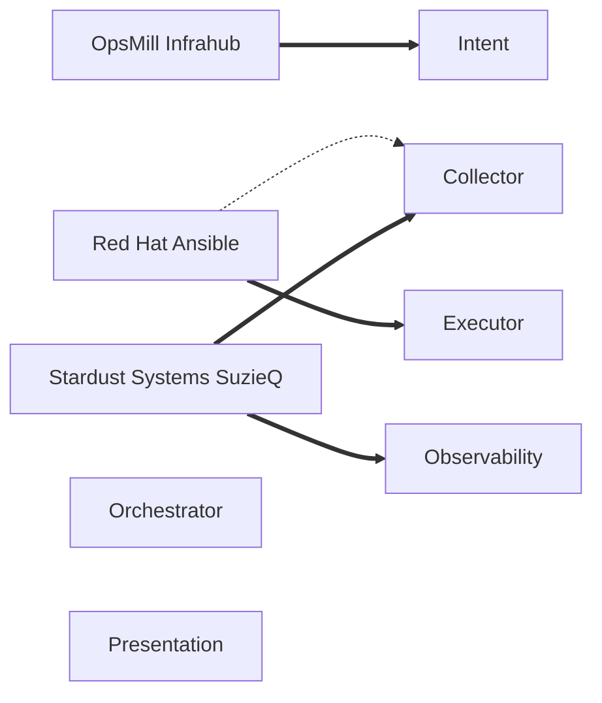

# Contract: Catalog Coverage Report

## Registration in `.infrahub.yml`

Added to the existing `queries` and `check_definitions` from feature 002:

```yaml
queries:
  - name: catalog_report
    file_path: queries/catalog_report.gql

python_transforms:
  - name: catalog_report
    class_name: CatalogReportTransform
    file_path: transforms/catalog_report.py

artifact_definitions:
  - name: catalog_coverage_report
    artifact_name: catalog-coverage-report
    content_type: text/markdown
    targets: catalog_reports
    transformation: catalog_report
    parameters:
      report: name__value
```

The query takes one variable, `$report: String!`, and reads the target report's name, every
building block, and every product with its claims.

## Report layout

Sections in this order. `<...>` marks values filled in from the data. Building blocks and
products are sorted by name, the same way in every section (FR-005).

1. `# <report name>`
2. A line stating the number of products, building blocks and coverage claims.
3. `## Coverage by product` with the Markdown table (FR-002): first column "Product", then one
   column per building block. Each cell is `Full`, `Partial` or `—`. If there are no products,
   the line "No products are recorded." replaces the table rows.
4. A line under the table: "Each claim's sources are listed on the claim in the catalog." (FR-009)
5. `## Products per building block` with a Mermaid `xychart-beta` (FR-003) and a line naming the
   two series.
6. `## Map of products to building blocks` with a Mermaid `flowchart LR` (FR-004) and a line
   stating that thick lines are full coverage and dotted lines are partial.

## Expected output for the catalog on `main` (2026-10-21)

````markdown
# Catalog coverage report

3 products, 6 building blocks, 5 coverage claims.

## Coverage by product

| Product | Collector | Executor | Intent | Observability | Orchestrator | Presentation |
|---|---|---|---|---|---|---|
| OpsMill Infrahub | — | — | Full | — | — | — |
| Red Hat Ansible | Partial | Full | — | — | — | — |
| Stardust Systems SuzieQ | Full | — | — | Full | — | — |

Each claim's sources are listed on the claim in the catalog.

## Products per building block

```mermaid
xychart-beta
    title "Products per building block"
    x-axis ["Collector", "Executor", "Intent", "Observability", "Orchestrator", "Presentation"]
    y-axis "Products" 0 --> 3
    bar [2, 1, 1, 1, 0, 0]
    bar [1, 1, 1, 1, 0, 0]
```



The first bar series counts all products that cover the block. The second, drawn over it, counts products with full coverage. The difference is partial coverage.

## Map of products to building blocks



Thick lines show full coverage. Dotted lines show partial coverage.
````

The y-axis maximum is the number of products, with a minimum of 1.
