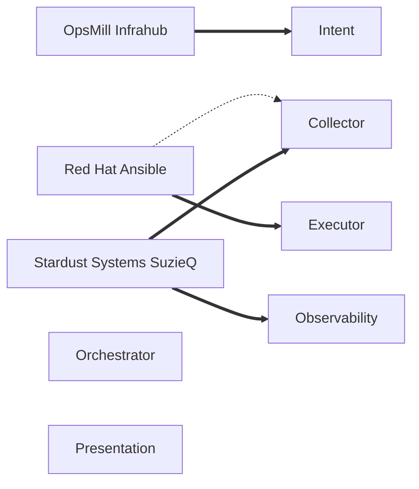

# Catalog coverage report

3 products, 6 building blocks, 5 coverage claims.

## Coverage by product

| Product | Collector | Executor | Intent | Observability | Orchestrator | Presentation |
|---|---|---|---|---|---|---|
| OpsMill Infrahub | — | — | Full | — | — | — |
| Red Hat Ansible | Partial | Full | — | — | — | — |
| Stardust Systems SuzieQ | Full | — | — | Full | — | — |

Each claim's sources are listed on the claim in the catalog.

## Products per building block

```mermaid
xychart-beta
    title "Products per building block"
    x-axis ["Collector", "Executor", "Intent", "Observability", "Orchestrator", "Presentation"]
    y-axis "Products" 0 --> 3
    bar [2, 1, 1, 1, 0, 0]
    bar [1, 1, 1, 1, 0, 0]
```

The first bar series counts all products that cover the block. The second, drawn over it, counts products with full coverage. The difference is partial coverage.

## Map of products to building blocks

Thick lines show full coverage. Dotted lines show partial coverage.
