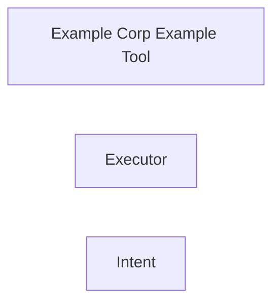

# Catalog coverage report

1 product, 2 building blocks, 0 coverage claims.

## Coverage by product

| Product | Executor | Intent |
|---|---|---|
| Example Corp Example Tool | — | — |

Each claim's sources are listed on the claim in the catalog.

## Products per building block

```mermaid
xychart-beta
    title "Products per building block"
    x-axis ["Executor", "Intent"]
    y-axis "Products" 0 --> 1
    bar [0, 0]
    bar [0, 0]
```

The first bar series counts all products that cover the block. The second, drawn over it, counts products with full coverage. The difference is partial coverage.

## Map of products to building blocks

Thick lines show full coverage. Dotted lines show partial coverage.
